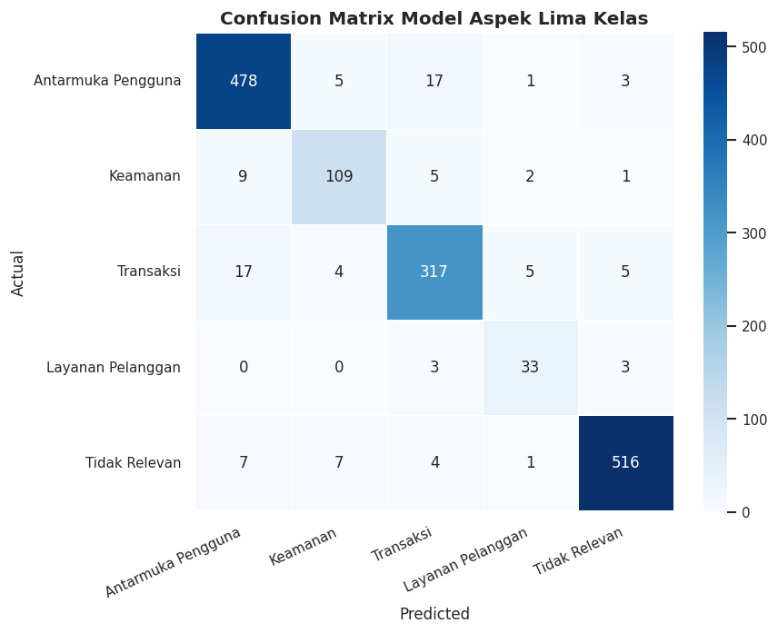
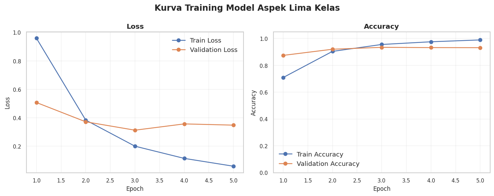
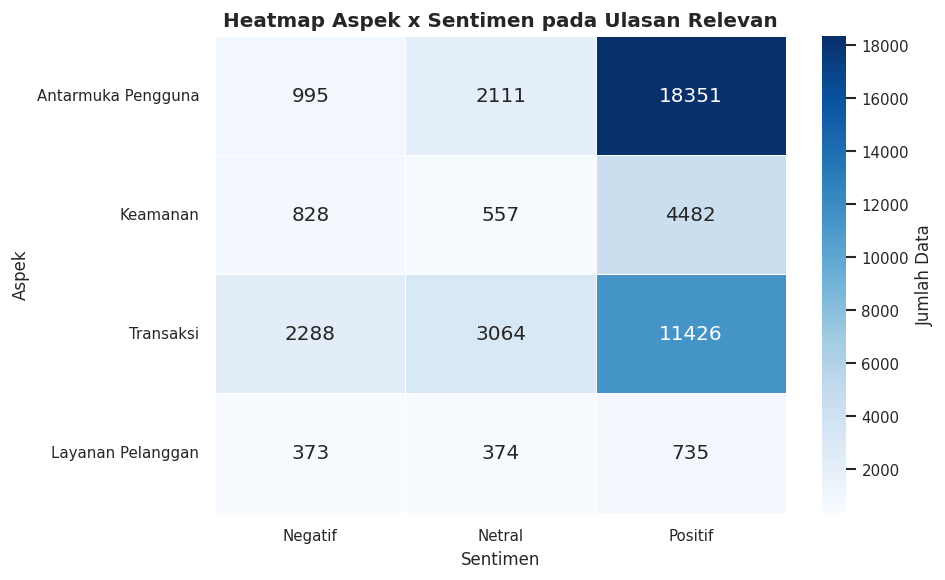
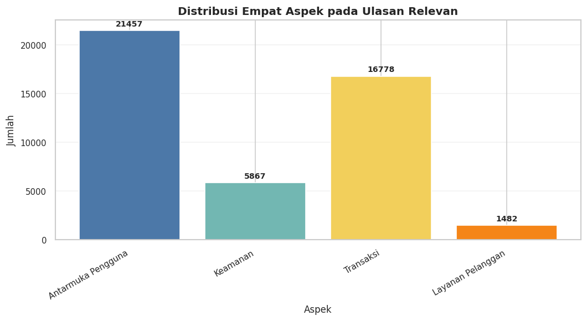
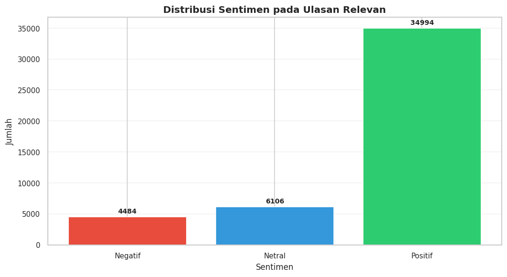
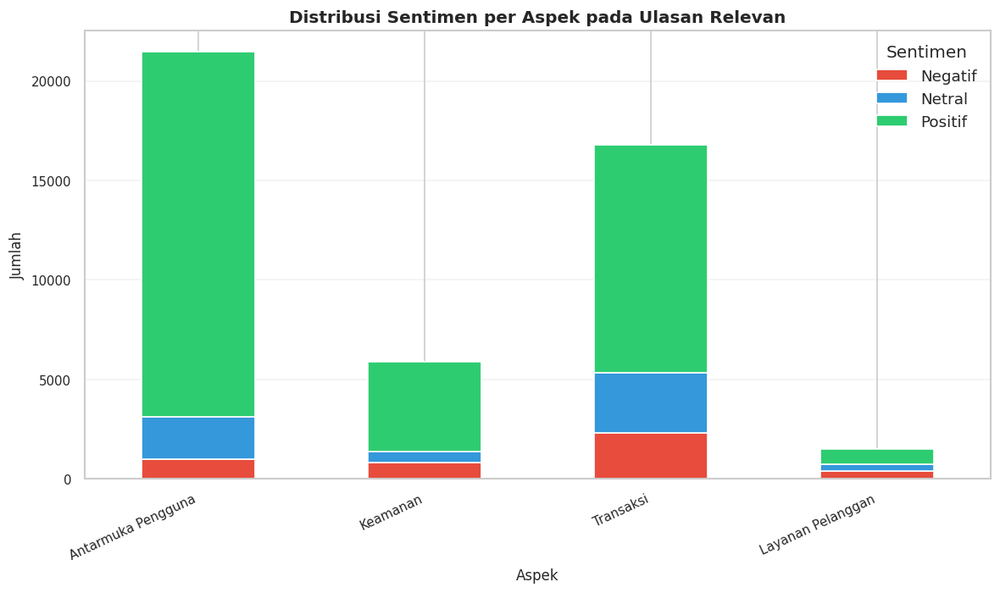

# Aspect-Based Sentiment Analysis of Indonesian Crypto Exchange Reviews

**Hybrid IndoBERT–BiLSTM | Indonesian NLP | Research Project (2026)**

This repository presents an end-to-end research workflow for **Aspect-Based Sentiment Analysis (ABSA)** of Indonesian-language Google Play reviews of **Indodax**, a cryptocurrency exchange application. The goal is to identify **which service aspect** users discuss and **how they feel about that aspect**, rather than assigning only an overall review sentiment.

> **Project scope:** Academic research implementation, not a deployed service. The notebooks are cleaned, publication-oriented copies of the original Google Colab workflows (selected non-sensitive charts retained). Training inputs, human-annotation spreadsheets, and trained checkpoints are **not included**, so the repository is **not directly runnable end-to-end** as published.

## At a glance

| Dataset or result | Value |
| --- | ---: |
| Collected Google Play reviews | **80,000** |
| Reviews retained after preprocessing | **68,204** |
| Reviews sampled for manual annotation | **8,000** |
| Human annotators | **3** |
| Final labeled reviews after reconciliation | **7,775** |
| Test samples | **1,552** |
| Relevant reviews identified in full-corpus inference | **45,584** |
| Irrelevant reviews identified in full-corpus inference | **22,620** |

### Test-set performance

| Evaluation setting | Accuracy | Macro F1 |
| --- | ---: | ---: |
| **Aspect classifier** (5 classes) | **93.62%** | **90.19%** |
| **Sentiment classifier**, using reference aspect | 93.22% | 86.26% |
| **Conditional sentiment pipeline**, using predicted aspect | 93.43% | 86.55% |
| **Joint aspect–sentiment**, 13 classes | 89.43% | 77.71% |

*These are distinct evaluation settings, not interchangeable model scores. Metrics are taken from the finalized undergraduate thesis; see the research methodology and limitations below.*

## Research question and approach

Overall review sentiment can obscure whether a complaint is about **transactions**, **account security**, **user interface**, or **customer support**. The system uses a conditional two-stage pipeline:

```text
Google Play reviews (80,000 collected)
        |
        v
Light preprocessing and filtering (68,204 clean reviews)
        |
        +--> Human annotation sample (8,000; three annotators)
        |         |
        |         v
        |    Fleiss' Kappa + majority voting (7,775 labeled reviews)
        |         |
        |         v
        |    Near-duplicate grouping + group-aware split
        |         |
        |         v
        |    Hybrid IndoBERT–BiLSTM model training
        |         |
        |         +--> Aspect classifier: 5 categories
        |         +--> Sentiment classifier: 3 categories
        |                 (only for relevant aspects)
        |
        v
Full-corpus inference with selected models
        |
        v
Aspect-level sentiment distribution, heatmaps, word analysis
```

The **aspect classifier** labels the dominant topic: `antarmuka_pengguna`, `keamanan`, `transaksi`, `layanan_pelanggan`, or `tidak_relevan`. `tidak_relevan` acts as a **relevance gate**; sentiment (`negatif`, `netral`, `positif`) is predicted only for the four substantive aspects. Each review receives a single dominant aspect, **not** a multi-label set of aspects.

The encoder is **IndoBERT** (`indobenchmark/indobert-base-p1`), followed by **BiLSTM** sequence modeling and task-specific classification. The research compares BiLSTM configurations and uses validation Macro F1 to choose models.

## Selected results

### Confusion matrix — aspect classification



### Training behavior — aspect classifier



### Aspect × sentiment across relevant reviews



The full-corpus analysis identifies the user interface as the most discussed relevant aspect. **Transactions** receive the largest absolute count of negative reviews (**2,288**), while **customer support** shows the highest negative share (**25.17%** of its reviews). These results describe opinions in the collected review corpus; they do not establish causes or measure the current quality of Indodax services.

<details>
<summary>Additional result charts</summary>

**Aspect distribution**



**Sentiment distribution**



**Sentiment breakdown by aspect**



</details>

## Repository structure

```text
.
├── README.md
├── requirements.txt
├── .gitignore
├── CITATION.cff
├── notebooks/
│   ├── 01_data_preparation.ipynb
│   ├── 02_annotation_and_dataset_preparation.ipynb
│   ├── 03_model_training_and_evaluation.ipynb
│   └── 04_full_corpus_analysis.ipynb
├── docs/
│   ├── methodology.md
│   ├── reproducibility.md
│   ├── model_card.md
│   └── figures/
│       └── [exported research figures]
└── portfolio/
    ├── linkedin_post_en.md
    ├── linkedin_project_description_en.md
    └── github_upload_guide_id.md
```

## Notebooks

| Notebook | Purpose |
| --- | --- |
| [01 — Data preparation](notebooks/01_data_preparation.ipynb) | Load the source review spreadsheet, standardize records, clean text and prepare annotation samples |
| [02 — Annotation and dataset preparation](notebooks/02_annotation_and_dataset_preparation.ipynb) | Verify three annotation files, calculate agreement, majority vote, group near-duplicates, split data, and oversample **training data only** |
| [03 — Training and evaluation](notebooks/03_model_training_and_evaluation.ipynb) | Train aspect and sentiment IndoBERT–BiLSTM classifiers, tune configurations and evaluate held-out data |
| [04 — Full-corpus analysis](notebooks/04_full_corpus_analysis.ipynb) | Restore selected checkpoints, infer aspect and sentiment for the corpus, generate visuals, and export summaries |

**Read before running:** [Reproduction and missing-input guide](docs/reproducibility.md). The original notebook workflows use **Google Colab / Google Drive paths** and require external files not distributed here.

## Evaluation and research safeguards

- Annotator agreement was assessed with **Fleiss' Kappa** (aspect **0.7609**, sentiment **0.8707**); labels were selected by **majority voting**.
- Near-duplicate reviews were grouped before splitting to reduce overlap risk between subsets.
- Research splits: **4,675 train**, **1,548 validation**, **1,552 test** after final label reconciliation (7,775 total).
- **Random oversampling was restricted to training data**.
- The best configuration was selected on validation Macro F1; the held-out test split was used for final evaluation.
- The sentiment classifier is conditional on a predicted relevant aspect. Joint ABSA Macro F1 (**77.71%**) is lower than the component-level metrics, indicating weaker performance in less-represented combined classes.

Additional methodological detail: [docs/methodology.md](docs/methodology.md). Model-specific disclosures: [docs/model_card.md](docs/model_card.md).

## Implementation environment

Python, PyTorch, Hugging Face Transformers, Pandas, NumPy, scikit-learn, Matplotlib, Seaborn, Google Colab and Google Drive. Main pretrained language model: `indobenchmark/indobert-base-p1`.

The supplied notebooks install some dependencies inside Colab and use its installed PyTorch/CUDA runtime. The `requirements.txt` file documents commonly required Python packages but **does not guarantee recreation of the original environment**.

## Data and publication status

The thesis reports collecting Google Play reviews, but the four notebooks supplied here **do not include the original crawling script**; Phase 1 starts from `indodax_reviews.xlsx`. Neither that spreadsheet nor the annotator files nor training checkpoints are included in this public package. See [reproducibility.md](docs/reproducibility.md) for expected inputs. No raw reviewer identities or signed thesis documents are intentionally distributed here.

This repository contains a summarized public presentation of an undergraduate research project; the complete signed thesis is **not** included. Publication of source data, annotations, and the full thesis should follow applicable university guidance, source-platform terms and privacy considerations.

## Author

**Muhammad Nouval Ghoizy**  
Undergraduate thesis, **Informatics — Universitas Ahmad Dahlan**, 2026.  
Original Indonesian thesis title: *Implementasi Hybrid Aspect-Based Sentiment Analysis dengan IndoBERT dan BiLSTM terhadap Review Aplikasi Exchange Cryptocurrency Indodax*.

If referencing the research, use [CITATION.cff](CITATION.cff). No reuse license has been selected for the code or figures yet; contact the author before assuming reuse rights.
